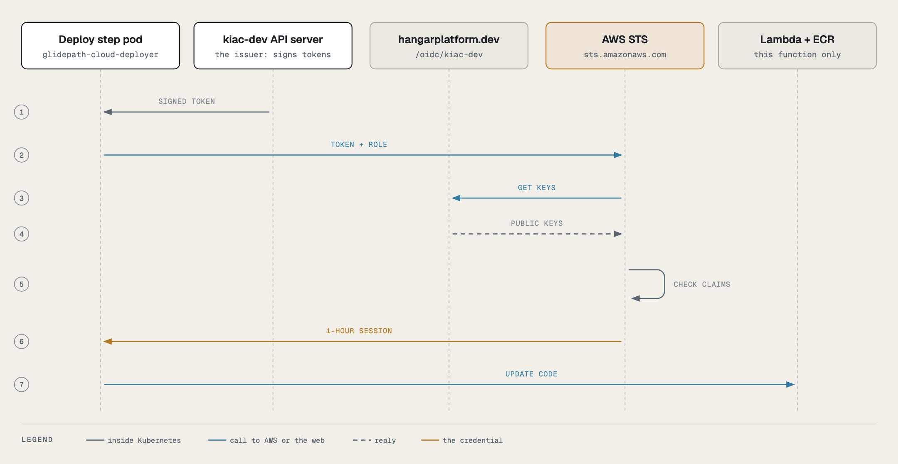
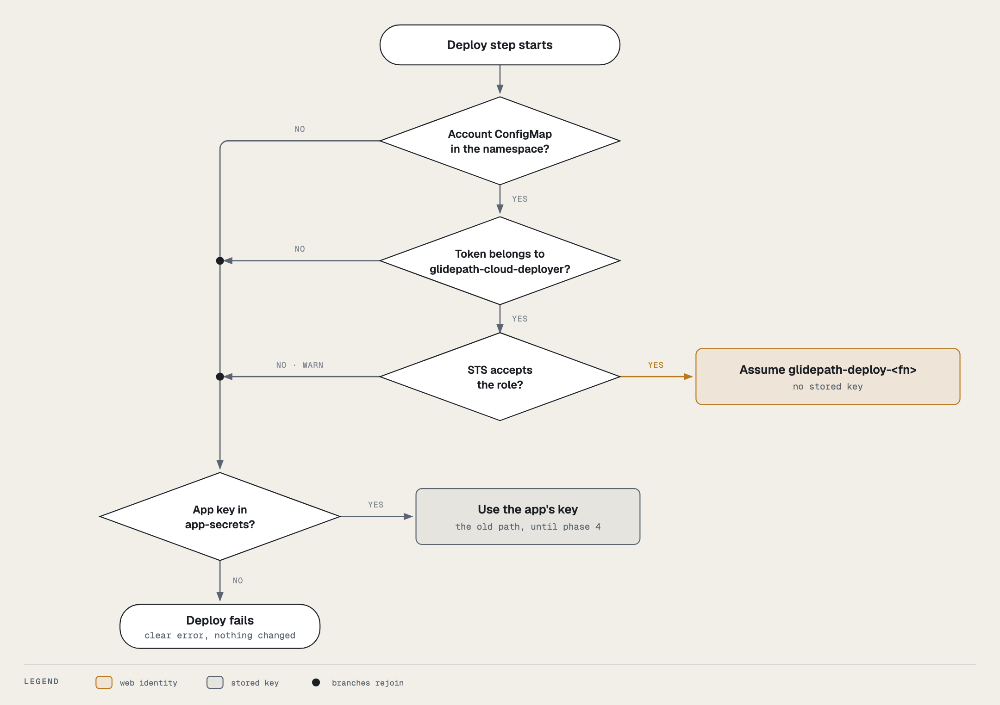

# Cloud deploy identity (AWS)

How Glidepath's deploy step reaches AWS without a stored key, written for someone new to it. The infrastructure
side (the roles, the issuer, the permissions boundary) lives in Airframe's `docs/admin/cloud-credentials.md`; this
page covers what Glidepath does.

## In one paragraph

Lambda and ECS deploys used to log in to AWS with an access key the app kept in Infisical: a password for a machine
that worked from anywhere until someone deleted it, shared by every app. Now the deploy step proves who it is with a
short-lived token Kubernetes signs for it, and AWS swaps that token for one hour of access to one IAM role made for
what it deploys: `glidepath-deploy-<functionName>` for a Lambda function, `glidepath-deploy-ecs-<service>` for an
ECS service. Each can push only to its own image repository and update only its own function or service. Nothing
is stored, and one app's pipeline can't touch another app's function or service.

## How a deploy gets its access



1. The deploy step's pod runs as the ServiceAccount `glidepath-cloud-deployer`. Kubernetes writes a token for it
   into the pod at `/var/run/secrets/aws-web-identity/token`, addressed to `sts.amazonaws.com` and valid for an
   hour (it is replaced before it expires).
2. The step sets `AWS_ROLE_ARN` and `AWS_WEB_IDENTITY_TOKEN_FILE`. The AWS command-line tool sees them and trades
   the token for credentials on its own; no step calls STS by hand.
3. AWS checks the token against the dev cluster's published keys (its registry `serviceAccountIssuer`, e.g. `https://<issuer-host>/oidc/<dev-cluster>`) and against
   the role's trust policy, which names exactly this namespace and ServiceAccount.
4. The step copies the image into the target's ECR repository and updates the function, or registers a new task
   definition and updates the service.

## The pieces, and who owns each

| Piece | What it is | Where it comes from |
|---|---|---|
| ServiceAccount `glidepath-cloud-deployer` | The only identity an app's deploy role trusts. No RBAC; its Kubernetes API token isn't mounted. | `glidepath-app` chart, `templates/identity/cloud-deployer.yaml` |
| ConfigMap `glidepath-cloud-identity` | `awsAccountId`, so the step can name the role without a `cicd.yaml` field | the same template |
| `cloudIdentity.awsAccountId` | Turns both on | forwarded by the control plane's tenant-onboarding ApplicationSet from `clusters.yaml` (`aws.accountId`) |
| Running the deploy tasks as that ServiceAccount | `taskRunSpecs` entries for `deploy-aws-lambda` and `deploy-aws-ecs`, each with `serviceAccountName: glidepath-cloud-deployer` | the deploy stage's TriggerTemplate (`flow-triggers.yaml`), and promote flows generated by `deliver-onboarding-files` |
| The login | `glidepath-catalog.awsCredentials` in `charts/glidepath-catalog/templates/_helpers.tpl`: each credential-using step of `deploy-lambda` and `deploy-ecs` calls `aws_credentials "<role name>"` | the catalog |
| The role `glidepath-deploy-<functionName>` | Created and deleted with the function | Airframe's `AwsLambdaTarget` |
| The role `glidepath-deploy-ecs-<service>` and the ECR repository `<service>` | Created and deleted with the service | Airframe's `AwsEcsTarget` |
| Who may run as the ServiceAccount | Four admission policies | gitops-cluster-dev `30-policy/kyverno-policies/glidepath-cloud-deployer.yaml` |

Only the `deploy` Pipeline contains `deploy-aws-lambda` and `deploy-aws-ecs` (both always, each run only for its
target), and Tekton refuses a `taskRunSpecs` entry that names a task its Pipeline lacks. That is why the entry is added only for the deploy stage, and only to flows rooted at `deploy`.
A promote flow picks it up at the next onboarding resync.

## How the step gets its access



The step checks three things in order: the namespace has `glidepath-cloud-identity`, the pod's token belongs to
`glidepath-cloud-deployer`, and STS accepts the role. If all hold it assumes the role; if one fails, the deploy stops
with an error that names the missing piece and its fix. There is no other way in: a key in `app-secrets` is not
read, and neither `deploy-lambda` nor `deploy-ecs` mounts `app-secrets` at all. A successful run logs:

```
credentials: assuming arn:aws:iam::700017004810:role/glidepath-deploy-glidepath-smoke-fn (web identity, no stored key)
credentials: assuming arn:aws:iam::700017004810:role/glidepath-deploy-ecs-smoke-ecs-dev (web identity, no stored key)
```

**Why there used to be a fallback, and why it's gone.** Until phase 4 the step fell back to the app's
`aws-access-key-id`/`aws-secret-access-key` when it couldn't assume the role. That covered the switch: a deploy that
ran before its function's role existed (the role is created a reconcile after the registry names the account) would
otherwise have failed. Once every Lambda app had deployed through its role, and no Secret on either cluster still
held an AWS key, the fallback was code that could only ever hand a deploy a long-lived key again, so it was removed
(2026-10-16). ECS followed the same day without a fallback: it had never used a key under web identity.
`charts/glidepath-catalog/tests/aws_credentials_test.sh` runs every login step of both Tasks through its real call
line, including "never reads a stored key".

## ECS: why the image goes to ECR

Fargate can pull from `ghcr.io`, but only from a public package unless every task definition carries a Secrets
Manager secret with registry credentials. The platform's packages are private by default (the first ECS run in
October needed its package made public by hand). So `deploy-ecs` copies the image into the ECR repository the
`AwsEcsTarget` creates, named after the service, where the task's execution role can always pull it, and registers
the task definition with that ECR digest. The copy keeps the digest, so the signatures and attestations on `ghcr.io`
still verify the deployed image. ECS accepts a multi-architecture image index, so the whole `image-ref` is copied
(Lambda needs a single-architecture image and copies the `-arm64`/`-amd64` tag instead).

## Why it is built this way

- **A dedicated ServiceAccount, not `pipeline-runner`.** Every pipeline step runs as `pipeline-runner`, including
  build and test steps that run the app's own code. Trusting it would give the test suite AWS access.
- **Admission by creator, not labels.** A PipelineRun's labels are copied onto its TaskRuns and pods, so a label check
  could be forged by an inline task. The policies check who created the pod, TaskRun or Job, which Kubernetes records
  and a client can't fake, and refuse a PipelineRun that gives the ServiceAccount to anything but the catalog's
  `deploy-aws-lambda` and `deploy-aws-ecs`, or that carries pod-template `env` (a `BASH_ENV` would run code inside the deploy step).
- **No `cicd.yaml` change.** The account comes from the platform. A schema change would have meant a toolbox rebuild
  (known gap 35) and one more value every app could get wrong.
- **The role is per function.** CloudTrail names the function and the TaskRun on every call, and one app can't reach
  another's function.

## Checking it

```bash
NS=app-<app>-cicd
kubectl -n $NS get sa glidepath-cloud-deployer
kubectl -n $NS get configmap glidepath-cloud-identity -o jsonpath='{.data.awsAccountId}'
# the deploy TaskRun's ServiceAccount and its credential line
TR=$(kubectl -n $NS get taskrun -l tekton.dev/pipelineTask=deploy-aws-lambda --sort-by=.metadata.creationTimestamp -o name | tail -1)
kubectl -n $NS get $TR -o jsonpath='{.spec.serviceAccountName}'
kubectl -n $NS logs "$(kubectl -n $NS get $TR -o jsonpath='{.status.podName}')" -c step-prepare | grep credentials
```

| Symptom | Cause | Fix |
|---|---|---|
| `error: no AWS account for cloud deploys in this namespace` | The ConfigMap `glidepath-cloud-identity` is missing | The cluster's `clusters.yaml` entry needs `aws.accountId`; check `cloudIdentity` reached the app (Argo CD `<app>-cicd`) |
| `error: this step is not running as glidepath-cloud-deployer` | The run didn't give the ServiceAccount to `deploy-aws-lambda` / `deploy-aws-ecs` | For a promote flow, run the onboarding resync; don't hand-edit `taskRunSpecs` |
| `error: could not assume … AccessDenied` | The role doesn't exist yet, or its trust names another namespace | Check the target's `<xr>-deploy` Role is Ready; a function or service without an `AwsLambdaTarget` / `AwsEcsTarget` has no role |
| `error: no ECR repository '<service>'` | The ECS service has no `AwsEcsTarget`, or its repository isn't created yet | Check the target's `ecr-repository` is Ready |
| `InvalidIdentityToken` | AWS can't fetch or verify the dev cluster's keys | `curl <serviceAccountIssuer>/jwks.json`; after a cluster rebuild, re-publish the cluster identity (Apron `clusterIdentity`) |
| A PipelineRun is refused by `glidepath-cloud-deployer-pipelineruns` | It gives the ServiceAccount to the wrong task, run-wide, or with pod-template `env` | Use the generated flow; don't hand-edit `taskRunSpecs` |

## Not covered yet

- **Azure Container Apps** uses a stored service principal secret; the same pattern applies through Azure workload
  identity federation.
